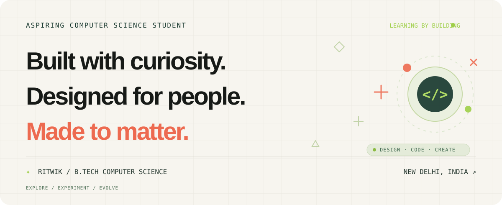

Hi, I'm Ritwik 👋
Aspiring Software Developer
Currently learning Java, C, and Web Development.

---
💻 Tech Stack
Languages & Web

Python Libraries

Tools & Platforms

---
🚀 Current Project
FWD.023 — a project I'm currently working on.
🌐 Portfolio
Explore my work: Ritwik's Portfolio
---
📊 GitHub Stats

📈 Contribution Activity

🏆 GitHub Trophies

---

